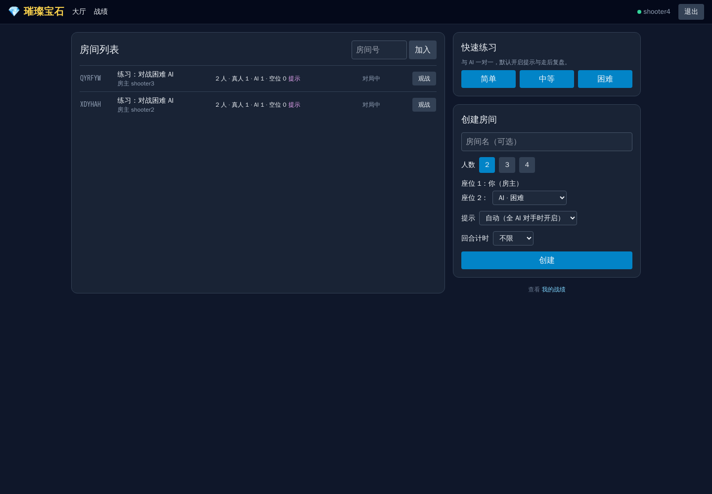
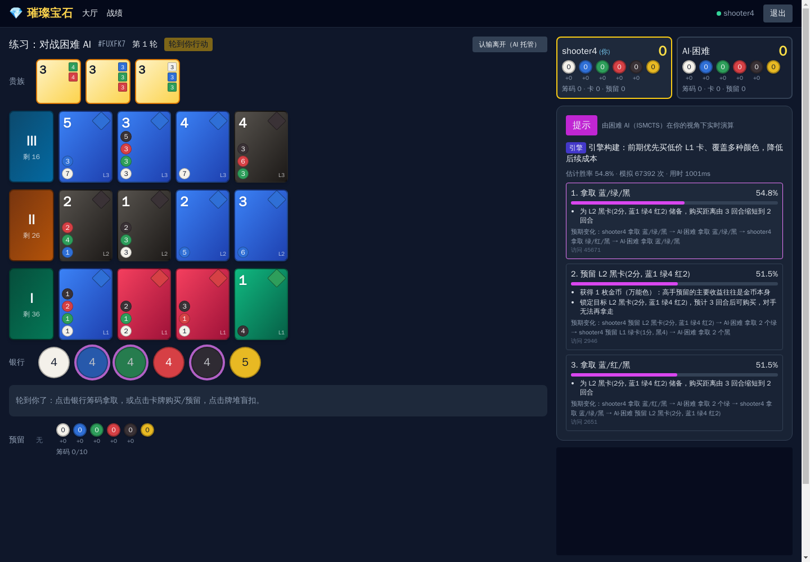
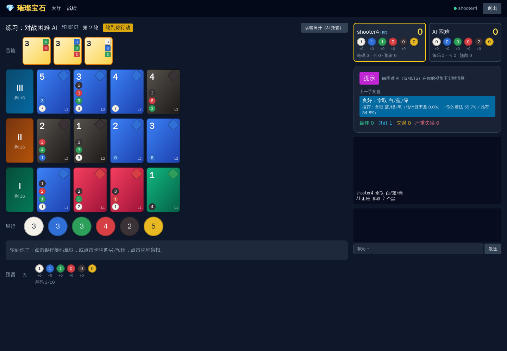
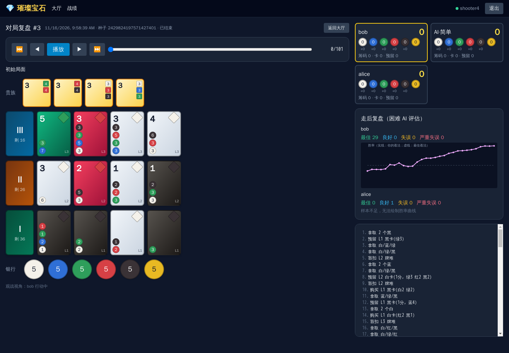

# 璀璨宝石 · 电子版

《璀璨宝石》（Splendor）基础版的联机实现：Go 服务端 + React Web 客户端 + Go 终端客户端（CLI）。

- **服务端权威**：规则判定、AI 计算、提示分析全部在服务端完成。每个客户端只收到按座位过滤后的视图，看不到牌堆顺序，也看不到对手从牌堆暗扣的牌。
- **账号**：用户名 + 密码（bcrypt 哈希）登录，签发 JWT（HS256，24 小时有效），数据存 SQLite（纯 Go 的 `modernc.org/sqlite`，无需 CGO）。
- **多人联机**：大厅、房间、2–4 人对局，可自由混合真人座位和简单 / 中等 / 困难 / 大师四档 AI；支持断线重连、回合计时。
- **房间持久化**：等待中和进行中的房间写入 SQLite，服务重启后自动恢复（含局面、提示缓存、胜率曲线与复盘）。无在线真人时对局暂停等待，断线真人不会被 AI 托管；长时间无人访问的房间按管理员配置的时长自动清理（默认 7 天）。
- **高手 AI 与提示**：困难和大师 AI 基于信息集 MCTS 实时演算，大师档使用更长预算与并行搜索，并在残局切换为精确搜索。提示功能默认使用大师 AI，给出前 3 个候选着法、各自胜率、预期后续着法以及中文原因；练习时每一步走完都会复盘，标出失误。
- **部署**：`./deploy.sh` 生成独立 Go 二进制和静态资源，生产环境由 nginx 托管前端并代理 API / WebSocket；`deploy/deploy.sh` 按本机其他服务的方式一键部署到 nginx 子路径 `/gem/`；也保留 `make build` 的 `embed` 单文件构建方式。

## 快速开始

构建依赖：Bash、Go 1.25+、Node 22+ 和 pnpm 10（验证版本为 10.33.4）。运行部署产物只需要 nginx 和 Go 二进制，不需要 Node / pnpm / Go 编译器。

```bash
./deploy.sh                                  # 编译产物到 dist/，nginx 部署见下文
sudo deploy/deploy.sh                        # 构建并部署到本机 nginx 的 /gem/ 子路径
```

本地也可以使用嵌入前端的单文件方式：

```bash
make build                                   # pnpm build → go build -tags embed，产物在 bin/
GEM_JWT_SECRET=change-me bin/gem-server        # 打开 http://localhost:8080
```

开发模式（Go 服务监听 :8080，Vite 监听 :5173，`/api` 和 `/ws` 由 Vite 代理到 :8080）：

```bash
make dev           # 同时启动两个服务，浏览器访问 http://localhost:5173
make dev-server    # 只启动后端
make dev-web       # 只启动前端
```

### nginx 部署（推荐）

`deploy.sh` 只安装锁定的构建依赖并编译产物，不复制到系统目录、不修改 nginx 配置、不启动或重启服务。脚本可从任意工作目录调用，产物总是位于项目根目录的 `dist/`：

```text
dist/
  bin/gem-server   # 无 CGO，不嵌入前端，只提供 API / WebSocket
  bin/gem-cli
  bin/gem-arena
  web/            # index.html、assets/ 等，交给 nginx 托管
```

默认编译当前主机平台；部署到其他平台时通过 Go 环境变量指定目标。构建命令可通过 `GO` / `PNPM` 覆盖，例如：

```bash
GOOS=linux GOARCH=amd64 ./deploy.sh
PNPM="corepack pnpm" ./deploy.sh
./deploy.sh --help
```

#### 本机子路径部署（`/gem/`）

与 wind / script-play 一致：nginx 在 443 上把 `/gem/` 反代到回环站点 `127.0.0.1:9095`，静态资源从 `/usr/share/nginx/gem` 提供，Go 后端只监听 `127.0.0.1:9096`。`deploy/deploy.sh` 会构建前端（`--base=/gem/`）、原子发布静态资源、安装 `gem-v2.service` 和两段 nginx 配置，并做内网与公网自检：

```bash
sudo deploy/deploy.sh
```

- 前端自动为 API、WebSocket 和 React Router 加上 `/gem/` 前缀，无需额外配置。
- 数据：`/var/lib/gem-v2/gem.db`；JWT 密钥：`/etc/gem-v2.env`（首次自动生成，重启保持不变）。
- 旧版 `gem.service`（v1）与 `/gem/`、9096 端口冲突，部署时会停用；两版数据库 schema 不兼容，旧账号不会迁移。
- 更新时重跑 `sudo deploy/deploy.sh`，不覆盖数据库与密钥。

如需把产物部署到其他机器或域名根路径，继续按下面的通用步骤操作。

1. 将 `dist/` 上传或复制到部署机器的 `/opt/gem/`，即 `/opt/gem/bin/` 和 `/opt/gem/web/`。让 nginx 用户拥有 `/opt/gem/web/` 及上级目录的读取、遍历权限；不要直接让 nginx 读取通常不可访问的 `/root/` 下目录。
2. 将 SQLite 数据单独放在 `/var/lib/gem/`，由后端运行用户拥有写权限。用该用户启动后端（目录需提前创建），并在进程管理器中配置开机自启及日志：

```bash
export GEM_JWT_SECRET='替换为高强度随机密钥，并在重启时保持不变'
export GEM_STATIC=''
/opt/gem/bin/gem-server -addr 127.0.0.1:8080 -db /var/lib/gem/gem.db
```

后端仅监听本机，由 nginx 对外提供服务。不传 `-static`，避免后端托管前端；数据库放在产物目录外，后续更新 `bin/` 和 `web/` 不会覆盖数据。

3. 将以下 `server` 配置加入 nginx 的 `http` 配置内（常见位置为 `/etc/nginx/conf.d/gem.conf`），替换域名和静态根目录：

```nginx
server {
    listen 80;
    server_name gem.example.com;
    root /opt/gem/web;
    index index.html;

    # 保留 /api/ 前缀；proxy_pass 不要添加尾部斜杠。
    location ^~ /api/ {
        proxy_pass http://127.0.0.1:8080;
        proxy_http_version 1.1;
        proxy_set_header Host $host;
        proxy_set_header X-Real-IP $remote_addr;
        proxy_set_header X-Forwarded-For $proxy_add_x_forwarded_for;
        proxy_set_header X-Forwarded-Proto $scheme;
    }

    # token 查询参数会随原始 URI 一起转发；禁止写入访问日志。
    location = /ws {
        proxy_pass http://127.0.0.1:8080;
        proxy_http_version 1.1;
        proxy_set_header Upgrade $http_upgrade;
        proxy_set_header Connection "upgrade";
        proxy_set_header Host $host;
        proxy_set_header X-Real-IP $remote_addr;
        proxy_set_header X-Forwarded-For $proxy_add_x_forwarded_for;
        proxy_set_header X-Forwarded-Proto $scheme;
        proxy_read_timeout 3600s;
        proxy_send_timeout 3600s;
        proxy_buffering off;
        access_log off;
    }

    # Vite 带哈希的资源可长期缓存，缺失资源必须返回 404。
    location ^~ /assets/ {
        try_files $uri =404;
        add_header Cache-Control "public, max-age=31536000, immutable";
    }

    location = /index.html {
        add_header Cache-Control "no-cache";
    }

    # React Router 深链接刷新时回退到入口页面。
    location / {
        try_files $uri $uri/ /index.html;
    }
}
```

4. 检查配置并重载已有 nginx 服务：

```bash
sudo nginx -t
sudo systemctl reload nginx
```

访问配置的域名即可使用 Web 客户端，`/api/healthz` 可检查后端是否可达。生产环境应在 nginx 配置 HTTPS 证书并重定向 HTTP；前端使用构建时的 `base` 拼接 API、WebSocket 与路由，HTTPS 下会自动切换为 `wss`。上面的示例挂在域名根路径；要与其他服务共用域名并挂在子路径（如 `/gem/`），使用 `deploy/deploy.sh`，它会在构建时传入对应的 `--base`。

更新时重新执行 `./deploy.sh`，替换服务器上的 `bin/` 与 `web/` 并重启后端，不替换数据库或 JWT 密钥。重启会短暂断开所有连接，但等待中/进行中的房间会在启动时从数据库恢复，重新进入即可继续对局。

### 服务端参数

| 参数 | 环境变量 | 默认值 | 说明 |
| --- | --- | --- | --- |
| `-addr` | `GEM_ADDR` | `:8080` | 监听地址 |
| `-db` | `GEM_DB` | `gem.db` | SQLite 文件路径 |
| `-secret` | `GEM_JWT_SECRET` | 随机 | JWT 密钥；不设置时每次重启都会生成新密钥，已签发的登录会失效 |
| `-static` | `GEM_STATIC` | 无（`embed` 构建时内嵌） | 可从指定目录提供前端；nginx 部署时不设置 |
| `-hard-ms` | | 300 | 困难 AI 每步的思考时间（单线程） |
| `-master-ms` | | 1500 | 大师 AI 每步的思考时间 |
| `-hint-ms` | | 1500 | 大师 AI 提示分析时间 |
| `-ai-delay-ms` | | 600 | AI 出手的最短展示延迟 |
| `-admin-user` | `GEM_ADMIN_USER` | `mango` | 启动时把该账号提升为管理员（空值禁用） |
| `-idle-close` | `GEM_IDLE_CLOSE` | `168h` | 无客户端连接的房间在该时长后自动关闭；`0` 表示不自动清理。仅作为 settings 表无记录时的初始值，管理页修改后以数据库为准 |

### 房间持久化与管理员

- 房间元数据存于 `rooms` 表；进行中的对局通过 `games.seed` + `game_actions` 重放恢复，提示缓存、胜率曲线、复盘分别持久化。已结束的对局只保留数据库记录，供战绩与回放查看，不再出现在房间列表中。
- 房间内没有任何在线真人时，回合调度（含回合计时与 AI 落子）暂停；有人重新加入后从当前局面继续。当前回合的真人离线时，对局等待其本人回来，不会由 AI 接管；只有在线真人超时才会由 AI 替走一步（房主开启回合计时时）。
- 管理员账号（默认 `mango`）在顶栏可见“管理”入口，可设置自动清理时长（`0` 为不清理）并手动关闭任意房间。自动清理同时会放弃未结束的对局；优雅重启（`systemctl restart` / 进程正常退出）不会中断或删除房间，只有管理员关房或超时清理才会。
- 系统服务可用 `Environment=GEM_ADMIN_USER=...` 与 `Environment=GEM_IDLE_CLOSE=...` 覆盖默认值；`/etc/gem-v2.env` 由部署脚本保留，可手动追加这两项。

### Docker

```bash
docker build -t gem-server .
docker run -d -p 8080:8080 -v gem-data:/data -e GEM_JWT_SECRET=change-me gem-server
```

这是保留的嵌入式单容器部署方式；nginx 托管部署使用上文的 `deploy.sh` 产物。镜像采用多阶段构建：node 构建前端，golang 编译出嵌入前端的二进制，最终运行在 alpine 上。SQLite 数据库位于 `/data/gem.db`，通过卷挂载持久化。镜像中也附带 `gem-cli`。

如果需要使用镜像源，可以传入构建参数：`--build-arg NPM_REGISTRY=... --build-arg GOPROXY=...`。

## Make 目标

| 命令 | 作用 |
| --- | --- |
| `make dev` | 同时启动 Go 服务和 Vite 开发服务器 |
| `make test` | `go vet` + `go test ./...` + 前端 `vitest` |
| `make build` | 构建前端，再编译 `bin/gem-server`（内嵌前端）、`bin/gem-cli`、`bin/gem-arena` |
| `make arena` | AI 自对弈评测，例如 `make arena A=master B=medium GAMES=500 PARALLEL=8 WORKERS=6` |
| `make docker` | 构建 Docker 镜像 |

如果 pnpm 不在 PATH 中，可以这样指定：`make build PNPM="npx pnpm"`。

## Web 客户端

各页面功能：

- **登录/注册**：登录后进入大厅。
- **大厅**：房间列表；创建房间时可设置人数、AI 座位及难度、是否允许提示、回合计时。
- **房间**：开局前房主可增删 AI 座位、调整难度；人数达到 2–4 人即可开局。
- **对局**：
  - 牌面：贵族行、三层发展卡（显示牌堆剩余张数，点击牌堆即可暗扣）、银行筹码。点选筹码组合时会即时校验是否合法。
  - 玩家信息：各玩家面板、自己的预留区、操作日志。
  - 弹窗：筹码超过 10 枚时弃牌，同时满足多位贵族时选择其一。
- **提示面板**：点「提示」会显示前 3 个候选着法、胜率条、中文原因和预期后续着法，并在牌面上高亮推荐的卡或筹码。练习时每步走完会显示复盘标记（胜率损失超过 5% 记为失误，超过 15% 记为严重失误）。
- **复盘**（`/games/:id`）：逐步回放整局，并显示整局胜率曲线。
- **战绩**（`/users/:id`）：个人战绩统计。

提示开关的默认值：只有你和 AI 的房间默认开启；有多名真人的房间由房主决定，默认关闭，以保证公平。

| 大厅 | 提示（前 3 候选 + 原因 + 预期后续） |
| --- | --- |
|  |  |
| **走后复盘** | **对局复盘与胜率曲线** |
|  |  |

## 终端客户端 `gem-cli`

```bash
bin/gem-cli login -server http://localhost:8080 -register alice   # 注册并登录，token 存到 ~/.config/gem/
bin/gem-cli rooms                                                 # 查看大厅
bin/gem-cli create -seats 3 -ai hard                              # 3 人房：你 + 困难 AI + 1 个空位
bin/gem-cli join ABC123                                           # 加入房间，或重连到进行中的对局
bin/gem-cli play -ai master,medium                                # 在服务器开一个练习房
bin/gem-cli play -offline -ai master -budget 1.5s                 # 离线对战本地 AI，不需要服务器
```

CLI 与 Web 使用同一套 HTTP/WS 协议，因此可以和网页玩家在同一个房间对局。棋盘下方是每位玩家独立的资源框（4 人为 2×2 排列），右下角预留面板默认显示自己的预留，按 `Tab` 可查看其他玩家。

**键位**

| 按键 | 作用 |
| --- | --- |
| 方向键 | 在 L3、L2、L1、银行、预留区之间移动光标 |
| `1`–`5` | 选择白、蓝、绿、红、黑；同一颜色按两次表示拿 2 枚 |
| 空格 | 在银行行选择光标所在颜色 |
| `Enter` / `t` | 拿取已选的筹码 |
| `b` | 购买光标所在的卡（明牌或自己预留的卡） |
| `r` | 预留光标所在的卡；光标在牌堆列时为暗扣 |
| `h` | 请求提示 |
| `y` | 执行提示的首选着法 |
| `Tab` | 右下角预留面板在玩家之间切换（默认显示自己的预留） |
| `s` | 房主开局 |
| `l` | 查看完整日志 |
| `q` | 退出 |

弃牌阶段：用 `1`–`6`（6 为金）累加要弃的筹码，按 `Enter` 确认。选贵族阶段：按 `1`–`9` 选择。

## 项目结构

```
deploy.sh        一键编译 nginx 部署产物到 dist/
deploy/          本机 nginx 子路径部署：deploy.sh、gem-v2.service、nginx 配置
cmd/gem-server   HTTP + WebSocket 服务
cmd/gem-cli      终端客户端（Bubble Tea）
cmd/gem-arena    AI 自对弈评测与调参
internal/engine  纯规则引擎：卡牌数据、阶段机、合法动作、视图过滤与确定化
internal/ai      特征、评估、四档 AI、残局搜索、提示解释、走后复盘
internal/arena   批量对局与统计
internal/auth    bcrypt、JWT、HTTP/WS 鉴权中间件
internal/store   SQLite 仓储与嵌入式迁移（users / games / game_actions / rooms / settings / 提示与曲线）
internal/game    大厅 Hub、房间 actor、AI 座位调度、对局持久化与重启恢复
internal/api     REST 路由、WebSocket 处理
internal/cli     终端界面、离线与联机后端
web/             React 18 + Vite + TypeScript + Tailwind + Zustand
```

**规则**：基础版全部 90 张发展卡（L1 40 张、L2 30 张、L3 20 张）和 10 位贵族。

- 筹码配置：2 人局每色 4 枚、3 位贵族；3 人局每色 5 枚、4 位贵族；4 人局每色 7 枚、5 位贵族；金币恒为 5 枚。
- 阶段流转：主行动 → 弃牌（持有筹码超过 10 枚时）→ 选贵族（同时满足多位时）→ 下一位玩家。
- 终局：任一玩家达到 15 分后打完本轮。分数最高者获胜；同分时购买发展卡较少者获胜；再相同则并列。

**协议**：REST 接口共 7 个，均以 `/api` 开头：

- `POST /api/auth/register`
- `POST /api/auth/login`
- `GET /api/me`
- `GET /api/rooms`
- `POST /api/rooms`
- `GET /api/games/{id}`
- `GET /api/users/{id}/stats`

WebSocket 地址为 `/ws?token=...`，消息统一使用 JSON 信封 `{type, roomId, payload, reqId}`：

- 客户端发送：`join_room`、`leave_room`、`set_seat`、`start`、`action`、`request_hint`、`chat`。
- 服务端推送：`room_state`、`game_view`、`events`、`hint`、`move_review`、`error`、`game_over`。

## AI 设计

所有 AI 都实现同一个接口 `Agent.Choose(ctx, view, seat)`。AI 只能看到 `ViewFor` 过滤后的信息：对手暗扣的牌和牌堆顺序都是未知的，困难和大师 AI 每次迭代都会随机补全这些隐藏信息（确定化），不作弊。

### 评估函数（依据 BGA 高手攻略整理）

`internal/ai/features.go`、`eval.go`、`weights.go`：

- **效率和节奏**：核心度量是 `turnsToAfford(card)`，即还需几个回合才能买下某张卡。计算时考虑已有奖励、手中筹码、金币、银行余量、每回合拿 3 枚不同色或 2 枚同色的限制，以及 10 枚筹码上限。整体目标是约 22 回合结束，大致相当于每 3 回合拿 2 分。
- **分阶段的引擎策略**：
  - 开局：奖励的价值按场上明牌和贵族对该颜色的需求加权，所以前期偏好便宜且能补齐颜色的 L1 卡。
  - 中盘：围绕少数几张目标高分卡，最小化拿到它们所需的回合数。
  - 后期（场上有人分数较高时）：奖励权重逐步让位于分数。
- **贵族**：按距离计算进度，越接近价值越高；同时考虑对手在同一位贵族上的竞争。
- **金币与预留**：预留的主要价值在于拿到金币，同时一张能买的目标卡也有价值；买不起的死预留会被扣分。
- **相对评估**：用自己的价值减去对手的价值，再通过 sigmoid 转换成胜率。这样能自然体现封锁收益，例如拿走对手需要的颜色，或预留掉对手的目标卡。
- **资源**：接近 10 枚筹码上限时，多余筹码有浪费惩罚。

### 四档难度

| 难度 | 做法 |
| --- | --- |
| 简单 | 只看一步，只评估自己的局面（不封锁，不考虑对手），用较高温度的 softmax 选择，并有 ε=0.1 的概率随机走一步合法动作 |
| 中等 | 使用完整评估函数，前 K 个候选做一轮前瞻：每个对手用启发式选出最佳回应后，再评估局面。附带威胁检测与封锁 |
| 困难 | 单线程 ISMCTS，默认每步搜索 300ms，结合残局搜索 |
| 大师 | 并行 ISMCTS，默认每步搜索 1.5s，结合残局搜索；也是提示与走后复盘的默认分析器 |

困难 / 大师 AI 的具体做法（`hard.go`、`endgame.go`）：

- **ISMCTS（信息集 MCTS）**：每次迭代对隐藏牌重新确定化。选择阶段采用 PUCT，先验概率来自启发式评分的 softmax。
- **动作剪枝**：只保留启发式排名前 K 的动作，买卡和预留始终保留。
- **rollout**：用轻量的 ε-贪心策略模拟若干步，然后截断，用评估函数估算胜率。
- **搜索预算**：困难档固定单线程、默认每步 300ms；大师档最多开 8 个 goroutine，各自建树，最后合并访问次数，默认每步 1.5 秒。
- **残局**：任一玩家达到 12 分或进入最后一轮时，并行运行 paranoid 深度搜索（假设对手全力压制自己）。搜索在多个确定化样本上精确判定必胜着法和必须封锁的着法，结果与树搜索融合。
- **离散子阶段**：弃牌、选贵族直接用评估函数选最优，不进入树搜索。

### 提示与原因

`explain.go`、`review.go`：提示由大师 AI 在玩家自己的视角上分析，返回以下内容：

- 前 3 个候选着法，每个附带估计胜率和访问次数。
- 预期后续着法（2–3 手）。
- 当前策略标签：引擎、冲分、贵族或封锁。
- 原因：对比动作前后的特征差、预期后续着法和威胁检测，生成结构化的 `ReasonTag`，再由客户端按中文模板渲染。

主要的原因标签：`WinNow`、`TempoPoints`、`NobleGet`、`NobleProgress`、`AffordNext`、`TargetProgress`、`GainGold`、`ReserveTarget`、`BlockOpponent`、`DenyBuy`、`ColorChoke`、`TokenWaste`、`Engine`。例如：

- 「购买后蓝色奖励达到 4，距贵族 X 仅差红色 1」
- 「对手 B 下回合可买 L3 卡达到 15 分，预留以阻断」
- 「黑色银行仅剩 1 枚，拿走可卡住对手 A 的目标卡」

走后复盘把实际走法和最佳着法的胜率差值作为损失：超过 5% 记为失误，超过 15% 记为严重失误。终局后可以在复盘页查看整局胜率曲线。

### 评测结果

`gem-arena` 用固定种子批量对局，A 方轮流坐每个座位，B 方坐其余座位。

| 对局 | 局数 | A 胜率 | 目标 |
| --- | --- | --- | --- |
| 中等 vs 简单（2 人） | 500 | 81.0% | ≥ 80% |
| 大师 vs 中等（2 人，1.5 s/步） | 500 | **96.8%**（大师平均每步思考 1.39 s） | ≥ 70%，单步 ≤ 2 s |
| 大师 vs 2×中等（3 人） | — | 75%（随机期望 33%） | — |

复现：

```bash
make arena A=medium B=easy GAMES=500 PARALLEL=16
make arena A=master B=medium GAMES=500 PARALLEL=8 WORKERS=6   # 48 核机器约 50 分钟
```

调参：`gem-arena -tune N` 会对中等 AI 的权重做爬山扰动，并输出建议写回 `weights.go` 的权重值。

## 测试

```bash
make test
```

覆盖范围：

- **引擎**：各动作的规则边界、阶段流转、终局与平局判定；随机合法动作跑 10k 局不 panic，且筹码总数和卡牌总数守恒；视图过滤不泄漏隐藏信息。
- **AI**：只使用视图（确定化测试），提示和复盘输出。
- **服务端**：auth、store，以及 WebSocket 集成全流程（2 名真人 + 2 个 AI 完整打一局）。
- **CLI**：按键映射成合法动作；离线与联机各完整打一局。
- **前端**：`vitest` 覆盖筹码选择和支付合法性等纯逻辑。
